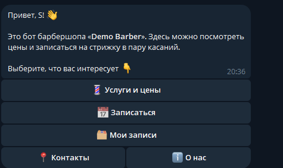
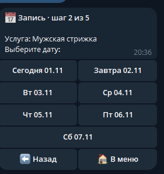
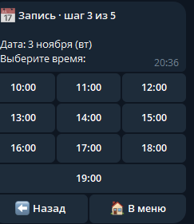
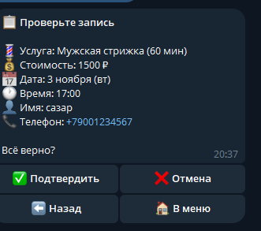
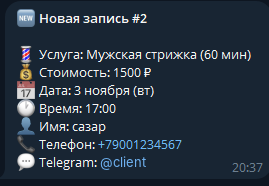
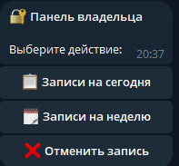
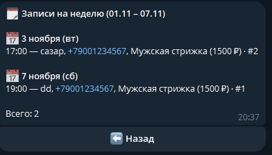

# 💈 Demo Barber — Telegram-бот для записи в барбершоп

Демо-проект для портфолио: Telegram-бот онлайн-записи в вымышленный барбершоп «Demo Barber».
Клиент выбирает услугу, дату и время и оставляет контакты, а владелец сразу получает уведомление.

**Стек:** Python 3.11+, aiogram 3, SQLite (aiosqlite), python-dotenv.

---

## Что умеет бот

### Для клиента
- **Главное меню** на inline-кнопках: «Услуги и цены», «Записаться», «Мои записи», «Контакты», «О нас».
- **Услуги и цены**: 5 услуг с ценой и длительностью.
- **Пошаговая запись (FSM):** услуга → дата (ближайшие 7 дней) → свободное время
  (10:00–19:00 каждый час, занятые и прошедшие слоты скрыты) → имя → телефон
  (кнопка «Поделиться номером» или ручной ввод с проверкой формата) → итог с кнопками «Подтвердить» / «Отмена».
- На каждом шаге есть кнопки **«Назад»** и **«В меню»**.
- **Мои записи**: будущие записи клиента, отмена с подтверждением.
- **Контакты** и **О нас**: адрес, часы работы, телефон.

### Для владельца
- Уведомление о каждой **новой записи** и **отмене** со всеми данными клиента.
- `/admin`: «Записи на сегодня», «Записи на неделю», отмена записи (клиенту уходит уведомление).
- `/id`: бот присылает любому пользователю его Telegram ID.

### Надёжность
- Бот не падает от случайного текста, стикеров, фото и голосовых сообщений.
- Старые и повторно нажатые кнопки не ломают сценарий: бот отвечает «кнопка устарела».
- Защита от двойной записи на одно время, в том числе на уровне базы (уникальный индекс).
- Повторное нажатие «Подтвердить» или «Отменить» не создаёт дублей и лишних уведомлений.

---

## Скриншоты

**Клиент**

| Главное меню | Выбор даты | Выбор времени | Подтверждение |
|:---:|:---:|:---:|:---:|
|  |  |  |  |

**Владелец**

| Уведомление о записи | Панель /admin | Записи на неделю |
|:---:|:---:|:---:|
|  |  |  |

---

## Структура проекта

```
demo-barber-bot/
├── bot.py                 # точка входа: запуск бота
├── app/
│   ├── config.py          # чтение настроек из .env
│   ├── shop.py            # услуги, расписание, контакты (меняйте под клиента)
│   ├── database.py        # работа с SQLite
│   ├── states.py          # шаги записи (FSM)
│   ├── callbacks.py       # данные inline-кнопок
│   ├── keyboards.py       # все клавиатуры
│   ├── utils.py           # время, форматирование, безопасная отправка
│   └── handlers/
│       ├── common.py      # /start, /id, услуги, контакты, о нас
│       ├── booking.py     # пошаговая запись
│       ├── my_bookings.py # «Мои записи» и отмена
│       ├── admin.py       # панель владельца
│       └── fallback.py    # реакция на всё непредусмотренное
├── requirements.txt
├── .env.example           # образец файла с настройками
└── .gitignore
```

---

## Как получить токен бота у @BotFather

1. Откройте в Telegram [@BotFather](https://t.me/BotFather) и нажмите **Start**.
2. Отправьте команду `/newbot`.
3. Введите **имя** бота (его видят пользователи), например `Demo Barber`.
4. Введите **username**: он должен заканчиваться на `bot`, например `demo_barber_test_bot`.
5. BotFather пришлёт **токен** вида `1234567890:AAH...`. Это пароль от бота: никому его не показывайте и не выкладывайте в интернет.

> Если токен утёк, выпустите новый: в @BotFather откройте `/mybots` → ваш бот → **API Token** → **Revoke current token**.

---

## Установка и запуск

Понадобится **Python 3.11 или новее**. Проверить версию можно командой `python --version`
(на macOS/Linux: `python3 --version`).

### Windows

1. Установите Python с [python.org/downloads](https://www.python.org/downloads/).
   В установщике **обязательно отметьте галочку «Add python.exe to PATH»**.
2. Скачайте проект (или `git clone ...`) и откройте папку проекта в терминале
   (в Проводнике: правый клик по папке → «Открыть в Терминале»).
3. Создайте виртуальное окружение и установите зависимости:
   ```powershell
   py -3.13 -m venv .venv
   .\.venv\Scripts\Activate.ps1
   pip install -r requirements.txt
   ```
   Вместо `3.13` подставьте свою версию Python, если она другая (`py --list` покажет установленные).
   Если PowerShell пишет «выполнение сценариев отключено», выполните один раз
   `Set-ExecutionPolicy -Scope CurrentUser RemoteSigned` и повторите активацию.
4. Создайте файл с настройками:
   ```powershell
   copy .env.example .env
   notepad .env
   ```
   Впишите токен после `BOT_TOKEN=` и сохраните файл.
5. Запустите бота:
   ```powershell
   python bot.py
   ```

### macOS / Linux

1. Установите Python 3.11+:
   - macOS: с [python.org/downloads](https://www.python.org/downloads/) или `brew install python`;
   - Ubuntu/Debian: `sudo apt install python3 python3-venv python3-pip`.
2. Откройте терминал в папке проекта и выполните:
   ```bash
   python3 -m venv .venv
   source .venv/bin/activate
   pip install -r requirements.txt
   cp .env.example .env
   nano .env          # впишите BOT_TOKEN, сохранить: Ctrl+O, Enter, выход: Ctrl+X
   python bot.py
   ```

### Как узнать свой ADMIN_ID

1. Запустите бота с одним только `BOT_TOKEN` (поле `ADMIN_ID` можно оставить пустым).
2. Напишите боту `/id`: он пришлёт число.
3. Впишите это число в `.env` после `ADMIN_ID=`.
4. Остановите бота (`Ctrl+C`) и запустите снова. Теперь вам доступны `/admin` и уведомления.

### Повторный запуск

В следующий раз достаточно открыть терминал в папке проекта, активировать окружение
(`.\.venv\Scripts\Activate.ps1` на Windows или `source .venv/bin/activate` на macOS/Linux)
и выполнить `python bot.py`. Бот работает, пока открыт терминал.

---

## Настройки (.env)

| Переменная | Обязательно | Описание |
|---|---|---|
| `BOT_TOKEN` | да | токен от @BotFather |
| `ADMIN_ID` | нет | Telegram ID владельца (узнать: `/id`) |
| `TIMEZONE` | нет | часовой пояс барбершопа, по умолчанию `Europe/Moscow` |

Услуги, цены, часы работы и контакты меняются в файле `app/shop.py`.

---

## Ограничения демо-версии

- Состояние незавершённой записи хранится в памяти: после перезапуска бота её нужно начать заново
  (уже подтверждённые записи сохраняются в `barber.db`).
- Один мастер: на каждое время возможна одна запись.

---

*Барбершоп, адрес и телефон вымышлены. Проект создан для демонстрации навыков.*
